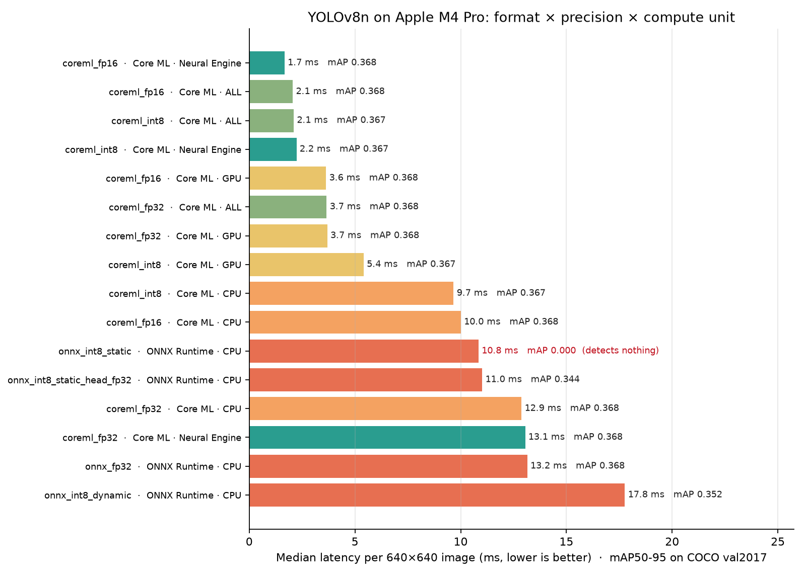

# edge-ml-bench

How much speed does a real-time object detector gain from lower precision and dedicated hardware, and how much accuracy does it give up?

This repo measures YOLOv8n (COCO, 640×640) across export formats, numeric precisions and compute units:

- **Apple silicon:** CPU, GPU and Neural Engine, through Core ML.
- **CPU:** ONNX Runtime.
- **Raspberry Pi:** ONNX Runtime and TFLite (LiteRT).

Every configuration gets the same measurements: latency, throughput, model size, memory and mAP. All results go into one table and one chart.



## Results

**MacBook Pro, Apple M4 Pro.** Each configuration was timed in 2 passes of 300 inferences after 20 warm-up runs. p50 is the median of the two passes. mAP50-95 is measured on COCO val2017 (5,000 images); the PyTorch FP32 baseline scores **0.368**. Raspberry Pi results are still to come.

| Variant | Backend | p50 (ms) | p50 range across runs | FPS | Size (MB) | mAP50-95 |
|---|---|---|---|---|---|---|
| `coreml_fp16` | Core ML · Neural Engine | 1.67 | 1.66–1.68 | 599 | 6.5 | 0.368 |
| `coreml_fp16` | Core ML · ALL | 2.06 | 1.66–2.46 | 485 | 6.5 | 0.368 |
| `coreml_int8` | Core ML · ALL | 2.10 | 1.73–2.48 | 475 | 3.4 | 0.367 |
| `coreml_int8` | Core ML · Neural Engine | 2.23 | 2.17–2.30 | 447 | 3.4 | 0.367 |
| `coreml_fp16` | Core ML · GPU | 3.63 | 3.42–3.85 | 275 | 6.5 | 0.368 |
| `coreml_fp32` | Core ML · ALL | 3.66 | 3.64–3.68 | 273 | 12.8 | 0.368 |
| `coreml_fp32` | Core ML · GPU | 3.69 | 3.68–3.70 | 271 | 12.8 | 0.368 |
| `coreml_int8` | Core ML · GPU | 5.41 | 5.40–5.42 | 185 | 3.4 | 0.367 |
| `coreml_int8` | Core ML · CPU | 9.66 | 9.66–9.67 | 103 | 3.4 | 0.367 |
| `coreml_fp16` | Core ML · CPU | 10.01 | 9.95–10.07 | 100 | 6.5 | 0.368 |
| `onnx_int8_static` | ONNX Runtime · CPU | 10.85 | 10.81–10.88 | 92 | 3.5 | **0.000** |
| `onnx_int8_static_head_fp32` | ONNX Runtime · CPU | 11.02 | 10.69–11.35 | 91 | 3.6 | 0.344 |
| `coreml_fp32` | Core ML · CPU | 12.88 | 12.84–12.92 | 78 | 12.8 | 0.368 |
| `coreml_fp32` | Core ML · Neural Engine | 13.05 | 12.81–13.29 | 77 | 12.8 | 0.368 |
| `onnx_fp32` | ONNX Runtime · CPU | 13.15 | 13.08–13.22 | 76 | 12.9 | 0.368 |
| `onnx_int8_dynamic` | ONNX Runtime · CPU | 17.77 | 17.38–18.15 | 56 | 3.5 | 0.352 |

Raw numbers: [`results/latency.csv`](results/latency.csv), [`results/accuracy.csv`](results/accuracy.csv).

Notes on reading the numbers:
- **`ALL` is not stable between runs.** With `ALL`, Core ML decides where each layer runs, and it chose differently from one run to the next: `coreml_fp16` took 1.66 ms in one pass and 2.46 ms in the other. Every other configuration stayed within about 5% across passes.
- **`coreml_int8` is weight-only quantization.** Weights are stored as INT8 (3.4 MB on disk) and expanded back to 16-bit floats for compute. `onnx_int8_static` quantizes the activations too.
- **coco128 scores look better than COCO val2017.** coco128 is drawn from COCO's training images, which YOLOv8n was trained on, so its mAP comes out about 0.08 higher. It is a quick check only; every mAP in the table above is from val2017.

## Findings

_To be written once the full runs are in._

## What gets compared

| Variant | Format | Precision | How it's made |
|---|---|---|---|
| `pytorch_fp32` | PyTorch | FP32 | Ultralytics baseline (accuracy reference) |
| `onnx_fp32` | ONNX | FP32 | Ultralytics export, opset 17, simplified |
| `onnx_int8_dynamic` | ONNX | INT8 weights | ONNX Runtime dynamic quantization |
| `onnx_int8_static` | ONNX | INT8 | ONNX Runtime static QDQ, calibrated on coco128 |
| `onnx_int8_static_head_fp32` | ONNX | INT8 + FP32 head | Same, with the detect-head decode kept in FP32 |
| `coreml_fp32` / `coreml_fp16` | Core ML | FP32 / FP16 | Ultralytics export |
| `coreml_int8` | Core ML | INT8 weights | Ultralytics export (weight quantization) |
| `tflite_fp32` / `tflite_int8` | TFLite | FP32 / INT8 | Ultralytics export (Raspberry Pi path) |

Backends:

- Core ML models run on each of `CPU_ONLY`, `CPU_AND_GPU`, `CPU_AND_NE` and `ALL`, so the same file is compared across the CPU, GPU and Neural Engine.
- ONNX models run on ONNX Runtime's CPU execution provider.
- TFLite models run on the LiteRT interpreter.

## Method

- **Latency:**
  - Each configuration runs 20 warm-up inferences first, so one-time compilation and caching don't count.
  - It then runs 200 timed inferences on a fixed 640×640 input.
  - Reported: median (p50), p95, mean and FPS.
  - Inference only: preprocessing and NMS are excluded, so the numbers isolate the model and the hardware.
- **Accuracy:** mAP50-95 and mAP50 from `ultralytics val`.
  - The quick runs use coco128 (128 images).
  - Final numbers use COCO val2017 (5,000 images): `make coco-val accuracy-full`. This downloads only the validation set (about 1 GB), not the 19 GB training set that Ultralytics' `coco.yaml` would also fetch.
  - Accuracy depends only on the model file, so it's measured once on the Mac and reused for other devices.
- **Size and memory:** size of the model on disk, and the process's resident memory after the run.
- **Results files:** every latency row records the device name, so Mac and Pi results share one CSV.

## Running it

```bash
make setup      # Python 3.12 virtualenv + dependencies
make export     # ONNX + Core ML variants into models/
make quantize   # ONNX Runtime INT8 variants (downloads coco128 for calibration)
make latency    # -> results/latency.csv
make accuracy   # -> results/accuracy.csv
make plot       # -> results/tradeoff.png
```

Useful flags:

- `python -m bench.latency --only coreml_fp16 --runs 500`
- `python -m bench.export --only tflite_fp32 tflite_int8` (needs TensorFlow; Ultralytics installs it on first use)

Raspberry Pi setup is in [PLAN.md](PLAN.md#raspberry-pi).

## Layout

```
bench/
  export.py         YOLOv8n -> ONNX / Core ML / TFLite variants
  quantize_onnx.py  ONNX Runtime INT8 (dynamic, static, static with FP32 head)
  latency.py        timing harness, one runner per backend / compute unit
  accuracy.py       mAP for every variant
  coco_val.py       downloads COCO val2017 (images + labels) only
  plot.py           latency vs. mAP chart
data/               dataset config for COCO val2017
models/             exported models (git-ignored, rebuilt by make export / quantize)
results/            CSVs and the chart
```

## Hardware

| Device | Details |
|---|---|
| MacBook Pro | Apple M4 Pro, 24 GB, macOS 27 |
| Raspberry Pi | _planned_ |
